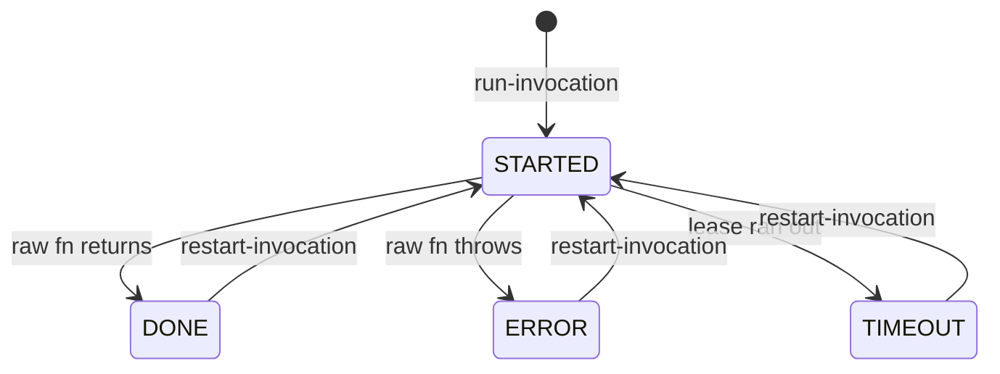

# tenon

A durable execution engine for Clojure functions on SQLite.

Every call of a workflow function is recorded in a database, together with its outcome. The records are used for:

- An audit log of what ran, when, with which arguments, and how it ended.
- Idempotency: a repeated call with the same arguments returns the stored result instead of running again.
- Manual restarts of failed or timed out workflows, from the REPL or the web UI.
- Detecting work left behind by a crashed process (leases and timeouts).

A web UI is provided for browsing and restarting workflows.

## Usage

Mark `defn` forms with `#workflow` to have their calls tracked. The namespace must require `tenon.workflow`, so that the `#workflow` reader tag can be resolved.

```clojure
(ns my.app.billing
  (:require tenon.workflow))

#workflow
(defn charge-card [customer-id idempotency-key amount]
  (payments/charge! customer-id amount)
  (email/send-charge-email customer-id amount)
  {:status :OK})
```

Every call to `charge-card` writes its start and its outcome into the database. Workflow functions can call other workflow functions: the whole call tree is recorded, and each nested call is tracked (and deduplicated) on its own.

Workflow functions run through the engine bound to `tenon.workflow/*workflow-engine*`, so bind it once at startup:

```clojure
(alter-var-root #'tenon.workflow/*workflow-engine*
                (constantly (tenon.workflow/init "app.db")))
```

Stop it with `(tenon.workflow/close! tenon.workflow/*workflow-engine*)`.

## Idempotency

A workflow is identified by its function's qualified name and its argument vector, printed as EDN (maps and sets in a canonical order, so `{:a 1 :b 2}` and `{:b 2 :a 1}` count as the same). When a call matches an existing workflow:

- If it is `DONE`, the stored result is returned and the function does not run.
- If it failed (`ERROR` or `TIMEOUT`), an `ex-info` with `:type :tenon.workflow/previous-failure` is thrown, describing the stored failure. The function does not run again until it is restarted.
- If it is still running (`STARTED`), the call waits for it to finish, then behaves as above.

Each such call is logged as a `REUSED` event. Stored results are kept and reused indefinitely: changing a workflow function's code does not invalidate them.

Things to keep in mind:

- Arguments must print as readable EDN. They form the idempotency key, and are read back to restart a workflow. Pass ids and values, not connections, Java objects or functions.
- Results (and exception data) should also be readable EDN, as they are read back when a call reuses them.
- Include something unique in the arguments (like `idempotency-key` above) when two calls with otherwise equal arguments must both run.

## Failures, timeouts and restarts

There are no automatic retries. A workflow that throws is recorded as `ERROR` and the exception is rethrown to the caller. To run it again, restart it:

```clojure
(tenon.workflow/restart-invocation invocation-id)              ; re-runs it under a new invocation id
(tenon.workflow/restart-invocation-recursively invocation-id)  ; restarts the failed nested workflow first
```

A restart requires the workflow function to be loaded in the restarting process. Its history is kept.

A running workflow holds a lease (`:tenon/timeout-ms`, 15 seconds by default) that a background thread of its process keeps renewing. If the process dies, the lease runs out and the workflow is moved to `TIMEOUT` - by a periodic sweep, or by the next call that meets it. Timed out workflows are not restarted automatically either. Pass `:tenon/timeout-ms nil` to disable leases.



## Configuration

Options are passed to `init` after the database path:

```clojure
(tenon.workflow/init "app.db"
                     :tenon/timeout-ms 60000
                     :tenon/on-event (fn [event data] (log/info event data))
                     :tenon/metadata-fn tenon.workflow/host-thread-metadata-fn)
```

- `:tenon/timeout-ms` - the lease of a running workflow (default 15000, `nil` never times out).
- `:tenon/heartbeat-ms`, `:tenon/sweep-ms` - how often leases are renewed and expired ones swept (default a third of the timeout, and the timeout).
- `:tenon/on-event` - called with an event keyword and a data map on `:started`, `:restarted`, `:done`, `:error`, `:reused`, `:timed-out`, `:lease-lost`, `:heartbeat-error` and `:sweep-error`. Useful for logging and metrics.
- `:tenon/metadata-fn` - see below.

See the docstring of `tenon.workflow/init` for the rest.

## Metadata

Every invocation is stored with metadata, which shows up in the web UI and as `:metadata` in the `:started`, `:restarted` and `:reused` events. By default it is an empty map (`empty-metadata-fn`). `host-thread-metadata-fn` provides the host name and the Java thread name the invocation was started from, e.g. `{:host "app-1" :thread "http-nio-8080-exec-3"}`.

To change it, pass a `:tenon/metadata-fn` when initializing the engine. It is called with the workflow type (the workflow function's qualified symbol) and the vector of its arguments, on the thread making the call, and returns the metadata to persist (any EDN-printable value, usually a map; `nil` stores nothing):

```clojure
(tenon.workflow/init "app.db" :tenon/metadata-fn (fn [wf-type args] {:actor-id 42}))
```

The function runs once per call: for a call that reuses a stored result, the metadata describes the reusing call, and a restart replaces the metadata with the restarting call's.

## Querying

- `(tenon.workflow/get-invocation id)` - the current state of a workflow.
- `(tenon.workflow/list-invocations {:state "ERROR" :limit 50})` - calls, newest first, with filters and seek-based pagination.
- `(tenon.workflow/list-pending)` - workflows still running.
- `(tenon.workflow/full-timeline id)` - every state of a workflow and of all its nested workflows.

## Web UI

The UI lives in the separate `http` module (ring, hiccup, cheshire). Mount it inside an existing ring app under a prefix:

```clojure
(require 'tenon.workflow.http)

(def app (tenon.workflow.http/wrap-handler engine "/tenon" my-handler))
```

or serve it standalone with `(tenon.workflow.http/app engine)`. Pages are also available as JSON or EDN, chosen by the `Accept` header.

The UI has no authentication and no CSRF protection, and it can restart workflows. Put it behind your own authentication and authorization middleware.

## Try it in the REPL

Start the REPL with `./run repl`.

```clojure
; Everything we may need
(require 'tenon.workflow 'tenon.workflow.server 'tenon.workflow.fixtures :reload-all)

; Start an engine
(def my-engine (tenon.workflow/init "/tmp/bbb"))

; Start the web UI (only for trying it out here, the jetty server is not part of the library)
(tenon.workflow.server/start! my-engine {})

; Bind to a dynamic var so that following workflow invocations have context.
(alter-var-root #'tenon.workflow/*workflow-engine* (constantly my-engine))

; Call a recursive function that has been marked with #workflow
(tenon.workflow.fixtures/fibonacci 20)
```

You can find the invocations in the web UI started at http://localhost:3000.

## Build tooling

- `./run repl` - REPL with some helpers.
- `./run test` - run the test suite.
- `./run deps` - pre-download all dependencies.
- `./run clean` - remove build/cache artifacts.

## AI disclaimer

AI coding agents were used to help implementing parts of the library (after years of thinking about it)
and most of the test suite. AI contributions are fine as long as they are also thought through and
solve real problems.

## Licence

Copyright (c) Janos Erdos. All rights reserved. The use and distribution terms for this software are covered by the Eclipse Public License 2.0 (https://www.eclipse.org/legal/epl-2.0/) which can be found in the file LICENSE.txt at the root of this distribution. By using this software in any fashion, you are agreeing to be bound by the terms of this license. You must not remove this notice, or any other, from this software.
