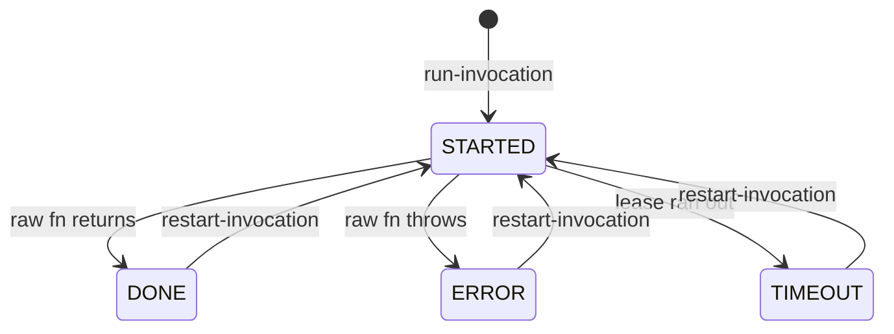

# tenon

A durable execution engine for Clojure functions on SQLite.

Every function invocation (and its result) is logged to a database table. The database is used for:

- Audit log of what happened.
- Idempotency based on function name and argument list.
- Retries on errors.
- Web UI is provided for browsing and managing.

## Usage

Mark `defn` forms with `#workflow` to have their invocations tracked.

```clojure
#workflow
(defn charge-card [customer-id idempotency-key amount]
  (payments/charge! customer-id amount)
  (email/send-charge-email customer-id amount)
  {:status :OK})
```

Every call to `charge-card` writes a database logs into the database. Marked functions can call other such functions and the whole call chain is tracked.

## Try it in the REPL

Start the REPL with `./run repl`.

```clojure
; Everything we may need
(require 'tenon.workflow 'tenon.workflow.server 'tenon.workflow.fixtures :reload-all)

; Start an engine
(def my-engine (tenon.workflow/init "/tmp/bbb"))

; Starting the API web server (only for testing here, jetty server is not part of the library.)
(tenon.workflow.server/start! my-engine {})

; Bind to a dynamic var so that following workflow invocations have context.
(alter-var-root #'tenon.workflow/*workflow-engine* (constantly my-engine))

; Call a recursive function that has been marked with #workflow
(tenon.workflow.fixtures/fibonacci 20)
```

You can find the invocations in the web UI started at http://localhost:3000.

## Metadata

Every invocation is stored with metadata, which shows up in the web UI and as `:metadata` in the `:started`, `:restarted` and `:reused` events. By default it is an empty map (`empty-metadata-fn`). `host-thread-metadata-fn` provides the host name and the Java thread name the invocation was started from, e.g. `{:host "app-1" :thread "http-nio-8080-exec-3"}`.

To change it, pass a `:tenon/metadata-fn` when initializing the engine. It is called with the workflow type (the workflow function's qualified symbol) and the vector of its arguments, on the thread making the call, and returns the metadata to persist (any EDN-printable value, usually a map; `nil` stores nothing):

```clojure
(tenon.workflow/init "app.db" :tenon/metadata-fn (fn [wf-type args] {:actor-id 42}))
```

The function runs once per call: for a call that reuses a stored result, the metadata describes the reusing call, and a restart replaces the metadata with the restarting call's.

## Versions

A call reuses the stored result of an earlier call with the same args, even after the function's code changed. To make calls run anew instead, give the function a `:version` - any EDN value - and bump it when the change should invalidate earlier results:

```clojure
#workflow
(defn charge-card
  {:version 2}
  [customer-id idempotency-key amount]
  ...)
```

The version is part of the workflow's identity, with its name and args: results recorded under another version (or none) are left alone, and stay in the history. Functions without a `:version` are unversioned, which is what every workflow recorded before versions existed is too - so they keep their results until a `:version` is added.

Code changes without a version bump are not ignored either: each invocation records system metadata - a hash of the function's code (`:code-hash`, insensitive to formatting, comments and the docstring) and its parameter lists (`:arglists`). Both show up in the web UI.

- **Reuse across a code change** - the result is reused, as the version is the same, but a `:code-changed` event (with `:recorded-code-hash` and `:code-hash`) warns about it.
- **Restart** runs the current code with the stored args, so it is refused when that can't work: when the function's version differs from the one the workflow was recorded under (`::version-mismatch` - call it again to run the new version), or when the stored args don't fit its parameter lists any more (`::signature-mismatch`). A renamed parameter restarts fine.

## State transitions



## Build tooling

- `./run repl` - REPL with some helpers.
- `./run test` - run the test suite.
- `./run deps` - pre-download all dependencies.
- `./run clean` - remove build/cache artifacts.

## AI disclaimer

AI coding agents were used to help implementing parts of the library (after years of thinking about it)
and most of the test suite. AI contributions are fine as long as they are also thought through and
solve real problems.

## Licence

Copyright (c) Janos Erdos. All rights reserved. The use and distribution terms for this software are covered by the Eclipse Public License 2.0 (https://www.eclipse.org/legal/epl-2.0/) which can be found in the file LICENSE.txt at the root of this distribution. By using this software in any fashion, you are agreeing to be bound by the terms of this license. You must not remove this notice, or any other, from this software.