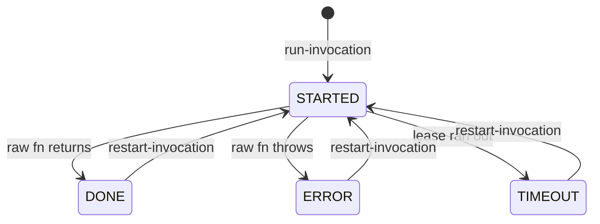

# tenon

A durable execution engine for Clojure functions on SQLite.

Every function invocation (and its result) is logged to a database table. The database is used for:

- Audit log of what happened.
- Idempotency based on function name and argument list.
- Retries on errors.
- Web UI is provided for browsing and managing.

## Usage

Mark `defn` forms with `#workflow` to have their invocations tracked.

```clojure
#workflow
(defn charge-card [customer-id idempotency-key amount]
  (payments/charge! customer-id amount)
  (email/send-charge-email customer-id amount)
  {:status :OK})
```

Every call to `charge-card` writes a database logs into the database. Marked functions can call other such functions and the whole call chain is tracked.

## Try it in the REPL

Start the REPL with `./run repl`.

```clojure
; Everything we may need
(require 'tenon.workflow 'tenon.workflow.server 'tenon.workflow.fixtures :reload-all)

; Start an engine
(def my-engine (tenon.workflow/init "/tmp/bbb"))

; Starting the API web server (only for testing here, jetty server is not part of the library.)
(tenon.workflow.server/start! my-engine {})

; Bind to a dynamic var so that following workflow invocations have context.
(alter-var-root #'tenon.workflow/*workflow-engine* (constantly my-engine))

; Call a recursive function that has been marked with #workflow
(tenon.workflow.fixtures/fibonacci 20)

; Stop the background threads and close the database when done
(tenon.workflow/close! my-engine)
```

You can find the invocations in the web UI started at http://localhost:3000.

## Engine lifecycle

`tenon.workflow/init` opens the database and starts the background threads that renew and sweep leases. It returns an engine that is a map and also `java.io.Closeable`. Close it once you are done:

```clojure
(with-open [engine (tenon.workflow/init "app.db")]
  (tenon.workflow/run-invocation engine #'my-wf my-wf-impl [42]))

; or by hand
(tenon.workflow/close! engine)
```

`close!` is idempotent and shuts down in this order:

1. New work is rejected: `run-invocation` and `restart-invocation` throw `:tenon.workflow/closed`. Workflows nested inside an invocation that is already running can still be called, so running work can finish.
2. It waits up to `:tenon/close-timeout-ms` (default `0`, so no wait) for the invocations running in this process to finish. Leases keep being renewed meanwhile.
3. The heartbeat and sweep threads stop.
4. The database is closed.

An invocation still running after that can't record its outcome, and its caller gets an exception. It stays `STARTED` until its lease runs out, then a sweep in any process moves it to `TIMEOUT`, the same as if the process had died. Pass e.g. `:tenon/close-timeout-ms 30000` to `init` to give running work a chance to finish on shutdown.

A copy made with `assoc` shares the database and threads of the original, so closing either one closes both. Only the code that called `init` should close the engine. Closing does not reset `*workflow-engine*`.

### With lifecycle libraries

The core has no dependency on any lifecycle library. Wiring the engine into one takes a few lines.

[Integrant](https://github.com/weavejester/integrant):

```clojure
(defmethod ig/init-key :tenon/engine [_ {:keys [db-path] :as opts}]
  (tenon.workflow/init db-path (dissoc opts :db-path)))

(defmethod ig/halt-key! :tenon/engine [_ engine]
  (tenon.workflow/close! engine))
```

[Component](https://github.com/stuartsierra/component):

```clojure
(defrecord WorkflowEngine [db-path opts engine]
  component/Lifecycle
  (start [this] (if engine this (assoc this :engine (tenon.workflow/init db-path opts))))
  (stop [this] (some-> engine tenon.workflow/close!) (assoc this :engine nil)))
```

[mount](https://github.com/tolitius/mount):

```clojure
(defstate engine
  :start (tenon.workflow/init "app.db")
  :stop (tenon.workflow/close! engine))
```

Since `#workflow` functions use `tenon.workflow/*workflow-engine*`, also set it once the engine starts, e.g. `(alter-var-root #'tenon.workflow/*workflow-engine* (constantly engine))`.

## Metadata

Every invocation is stored with metadata, which shows up in the web UI and as `:metadata` in the `:started`, `:restarted` and `:reused` events. By default it is an empty map (`empty-metadata-fn`). `host-thread-metadata-fn` provides the host name and the Java thread name the invocation was started from, e.g. `{:host "app-1" :thread "http-nio-8080-exec-3"}`.

To change it, pass a `:tenon/metadata-fn` when initializing the engine. It is called with the workflow type (the workflow function's qualified symbol) and the vector of its arguments, on the thread making the call, and returns the metadata to persist (any EDN-printable value, usually a map; `nil` stores nothing):

```clojure
(tenon.workflow/init "app.db" :tenon/metadata-fn (fn [wf-type args] {:actor-id 42}))
```

The function runs once per call: for a call that reuses a stored result, the metadata describes the reusing call, and a restart replaces the metadata with the restarting call's.

## State transitions



## Build tooling

- `./run repl` - REPL with some helpers.
- `./run test` - run the test suite.
- `./run deps` - pre-download all dependencies.
- `./run clean` - remove build/cache artifacts.

## AI disclaimer

AI coding agents were used to help implementing parts of the library (after years of thinking about it)
and most of the test suite. AI contributions are fine as long as they are also thought through and
solve real problems.

## Licence

Copyright (c) Janos Erdos. All rights reserved. The use and distribution terms for this software are covered by the Eclipse Public License 2.0 (https://www.eclipse.org/legal/epl-2.0/) which can be found in the file LICENSE.txt at the root of this distribution. By using this software in any fashion, you are agreeing to be bound by the terms of this license. You must not remove this notice, or any other, from this software.